<h1 align="center">Prajwal Ghurde</h1>

  

  
  
  
  

 

<table border="0" cellpadding="0" cellspacing="0">
  <tr>
    <td width="32%" align="center" valign="middle">
      
    </td>
    <td width="68%" valign="middle">
      
I am a <b>Software Engineer specializing in Generative AI and full-stack development</b>, with hands-on experience building LLM, RAG, NLP, and scalable backend systems.

      
At <b>IIT Hyderabad (NLIP Lab)</b>, I worked on cultural text adaptation, retrieval, and research intelligence systems with strong focus on quality and reliability.

      
At <b>VTEX.AI</b>, I built and optimized microservices and production REST APIs, contributing to measurable performance gains and stable release workflows.

    </td>
  </tr>
</table>

---

## What I'm Shipping Lately

- **AI Research Paper Intelligence System** — semantic search, RAG Q&A, summarization, keyphrase/entity extraction, and similar-paper discovery.
- **VisionRAG** — video understanding + embeddings + vector search + LLM reasoning for natural-language CCTV search.
- **PharmaGuard** — counterfeit medicine verification platform with OCR, barcode/GS1, AI verification, and secure reporting workflows.

---

## How I Think About the Work

- **Systems over isolated models** — real value comes from retrieval, orchestration, evaluation, and reliability around the model.
- **Production clarity** — prioritize measurable improvements: latency, quality, maintainability, and predictable behavior.
- **Practical AI engineering** — combine modern AI stacks (LLMs/RAG) with robust backend fundamentals and deployment discipline.

---

## What I Keep Running

Shipping features is one step. Keeping systems dependable over time is the larger discipline.

- Built and maintained backend services with validation, authentication, and clear API contracts.
- Worked across DEV/PROD environments and release workflows with CI/CD and deployment best practices.
- Contributed through Agile cycles: implementation, debugging, reviews, testing, and documentation.

---

## How I Navigate the Work

Not every problem lives in the same place. I map what I build to the [Cynefin](https://en.wikipedia.org/wiki/Cynefin_framework) domains — because the right approach for a known CRUD API is the wrong approach for a non-deterministic AI workflow.

  

---

## Featured Projects

| Project | What it is |
| --- | --- |
| **AI Research Paper Intelligence System** | IIT Hyderabad project combining NLP, Information Retrieval, and Generative AI for paper analysis and insight extraction. |
| **VisionRAG - Video RAG & Semantic Surveillance Search** | Multimodal retrieval system over video/CCTV content using embeddings, vector search, and LLM-based response generation. |
| **PharmaGuard - AI-Powered Counterfeit Medicine Detection** | Medicine verification platform with OCR, AI-assisted validation, JWT auth, scan history, offline support, and admin monitoring. |
| **Promptify - AI Chat Application** | Full-stack AI chat app with OpenAI integration, modular APIs, logging, validation, and AWS EC2 + Nginx deployment. |
| **Finnova (Flyte Dashboard)** | Full-stack investment platform for trading and portfolio insights with secure auth and analytics dashboarding. |
| **Ghoomify - Property Listing Platform** | Backend APIs for auth/property operations using Node.js, Express.js, MongoDB, and Passport.js security flows. |

---

## Latest Works

<!-- LATEST-WORKS:START -->
- [Constrained Decoding Models: What If AI Didn’t Need to Generate Every Token?](https://medium.com/@TheFutureWorkforce/constrained-decoding-models-what-if-ai-didnt-need-to-generate-every-token-b5e79042d219)
- [Jev: What If AI Didn’t Need to Generate Text?](https://medium.com/@TheFutureWorkforce/jev-what-if-ai-didnt-need-to-generate-text-5d3db88c68f3)
- [I Replaced 5 Tools With One AI Agent — Here’s What Happened](https://medium.com/@TheFutureWorkforce/i-replaced-5-tools-with-one-ai-agent-heres-what-happened-26e04c0e2ec9)
- [Goodbye Apps, Hello AI Agents: The Death of Traditional Software in 2025](https://medium.com/@TheFutureWorkforce/goodbye-apps-hello-ai-agents-the-death-of-traditional-software-in-2025-38222c5c477c)
- [AI Agents Are the New Apps: Why Autonomous AI Is the Future of Productivity](https://medium.com/@TheFutureWorkforce/ai-agents-are-the-new-apps-why-autonomous-ai-is-the-future-of-productivity-3412bd4d08f5)
- [Meta’s $15 Billion Superintelligence Bet: Game-Changer or Risk?](https://medium.com/@TheFutureWorkforce/metas-15-billion-superintelligence-bet-game-changer-or-risk-b28ad0688603)
- [Building a Smart AI Vision System with ESP32-CAM and GPT-4o](https://medium.com/@TheFutureWorkforce/building-a-smart-ai-vision-system-with-esp32-cam-and-gpt-4o-66caf074ca68)
- [AI Girlfriends: The Rise of Artificial Intimacy in the Age of Loneliness](https://medium.com/@TheFutureWorkforce/ai-girlfriends-the-rise-of-artificial-intimacy-in-the-age-of-loneliness-46edec320162)
<!-- LATEST-WORKS:END -->

---

## Skills

- **Languages:** Python, Java, JavaScript, SQL
- **Generative AI & AI:** LLMs, RAG, NLP, Information Retrieval, AI Agents, LangChain, LangGraph, Vector Databases, LLM Evaluation
- **Backend & Architecture:** Node.js, Express.js, REST APIs, Microservices
- **Frontend:** React.js, HTML, CSS, Tailwind CSS
- **Databases:** MongoDB, Relational Databases
- **Cloud & DevOps:** AWS (EC2, S3, Lambda), Nginx, GitHub Actions, CI/CD
- **Tools:** Postman, Git, GitHub

---

  <b>What I'm up for.</b> 
  Building production-ready AI and full-stack systems that are reliable, measurable, and practical. 
  Open to collaborating on Generative AI, RAG pipelines, backend architecture, and research-to-product engineering.

  
  

